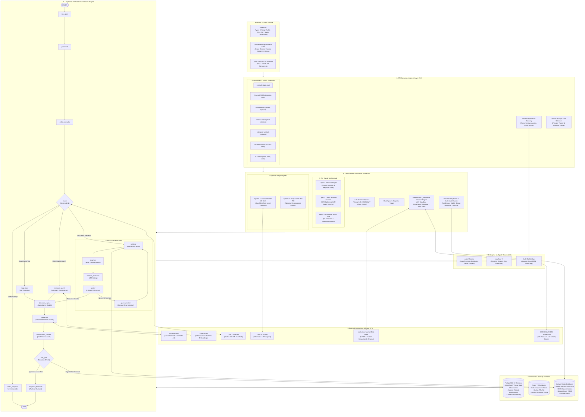
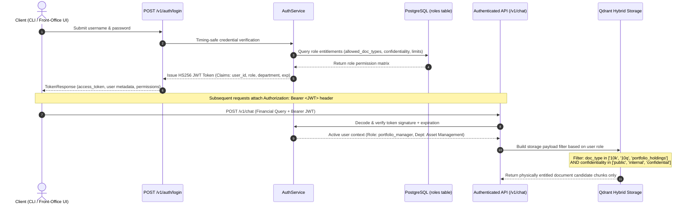
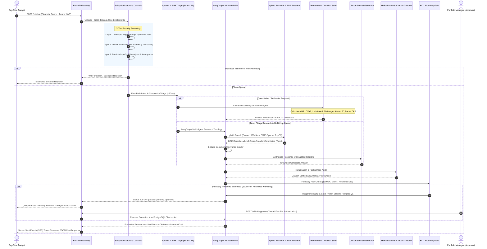

# FinRAG: Institutional Multi-Agent Investment Research & Quantitative Decision Platform

[](.github/workflows/ci.yml)
[](https://www.python.org/)
[](https://github.com/langchain-ai/langgraph)
[](https://modelcontextprotocol.io/)
[](https://qdrant.tech/)
[](docs/mrg_validation_report.md)
[](LICENSE)
[](https://github.com/astral-sh/ruff)

An institutional-grade, multi-agent AI investment research and quantitative decision platform engineered for buy-side asset managers, hedge funds, sovereign wealth funds, and quantitative research teams. Powered by **LangGraph**, **Model Context Protocol (MCP)**, **Hybrid Dense-Sparse Vector Retrieval**, **Cross-Encoder Neural Reranking**, and **Deterministic Quantitative Models**, FinRAG automates fundamental equity analysis, SEC EDGAR XBRL ingestion, portfolio risk estimation (VaR/CVaR, Ledoit-Wolf shrinkage, factor attribution), and fiduciary compliance governance.

---

## Table of Contents

- [Executive Overview & Problem Statement](#executive-overview--problem-statement)
- [System Architecture](#system-architecture)
- [Request Lifecycle & Data Flow](#request-lifecycle--data-flow)
- [Core Platform Capabilities](#core-platform-capabilities)
- [Quantitative Decision Suite & Risk Governance (Fed SR 11-7)](#quantitative-decision-suite--risk-governance-fed-sr-11-7)
- [Model Context Protocol (MCP) Server Specification](#model-context-protocol-mcp-server-specification)
- [Buy-Side Role-Based Access Control (RBAC)](#buy-side-role-based-access-control-rbac)
- [Human-in-the-Loop (HITL) Fiduciary Governance](#human-in-the-loop-hitl-fiduciary-governance)
- [REST & Protocol API Reference](#rest--protocol-api-reference)
- [Security Architecture & Threat Mitigation](#security-architecture--threat-mitigation)
- [Performance & Scalability Benchmarks](#performance--scalability-benchmarks)
- [Observability, Tracing & Cost Accounting](#observability-tracing--cost-accounting)
- [Technology Stack](#technology-stack)
- [Installation & Local Development](#installation--local-development)
- [Production Deployment & Hardening](#production-deployment--hardening)
- [Contributing Guidelines](#contributing-guidelines)
- [License](#license)

---

## Executive Overview & Problem Statement

### The Institutional Challenge
Front-office investment analysts, risk officers, and portfolio managers face four fundamental roadblocks when deploying generative AI in institutional asset management:

1. **Arithmetic & Formula Hallucination**: Generative language models are probabilistic text predictors. They routinely hallucinate financial multiples, miscalculate accounting restatements, and invert risk metrics (e.g. producing negative VaR).
2. **Context Window Saturation & Entity Drift**: Regulatory filings (10-Ks, 10-Qs, 8-Ks) span hundreds of dense pages with complex multi-year financial tables. Standard RAG pipelines confuse fiscal years, mix entity facts, and fail on tabular comparisons.
3. **Data Contamination & Entitlement Breaches**: Asset managers operate under fiduciary information barriers. Private mandate holdings, restricted watchlists, and confidential investment memos must never leak across departments or unauthorized roles.
4. **Model Risk Governance Mandates**: Under **Federal Reserve SR 11-7** and **OCC 2011-12**, models used in investment decision-making must undergo strict conceptual soundness testing, input boundary validation, matrix conditioning checks, and deterministic audit tracking.

### The FinRAG Solution
- **Deterministic Offloading**: All numerical calculations, portfolio optimizations, and risk simulations are strictly offloaded from generative LLMs to AST-isolated, unit-tested quantitative mathematical engines.
- **Dual-System Cognitive Architecture**: A fast System 1 Small Language Model (SLM) triages queries in sub-50ms, while a System 2 deep research LangGraph orchestrator decomposes complex multi-statement inquiries across 20 specialized nodes.
- **Storage-Layer RBAC Filtering**: Role entitlements are enforced directly within Qdrant vector index payload filters. Unauthorized chunks are physically excluded from index scans and never touch LLM context windows.
- **Automated SR 11-7 Validation Battery**: Built-in automated governance validators continuously benchmark mathematical outputs, test boundary conditions, check covariance matrix conditioning, and emit institutional audit dossiers.

---

## System Architecture

FinRAG is structured around an institutional, multi-layered architecture designed for sub-second financial reasoning, deterministic mathematical accuracy, and strict fiduciary information barriers.

### Architectural Component Decomposition



---

## Authentication & Authorization Flow

FinRAG implements timing-safe authentication and strict storage-level Role-Based Access Control (RBAC). Document entitlements are applied directly to Qdrant vector database query filters, guaranteeing that unauthorized chunks are physically omitted from vector index traversals and never enter the LLM context window.



---

## Request Lifecycle & Data Flow

Every investment research query follows an audited multi-stage path with 3-tier security screening, dual-system cognitive triage, deterministic mathematical offloading, hallucination verification, and human-in-the-loop authorization gates.



---

## Core Platform Capabilities

- **20-Node LangGraph State Orchestration**: Stateful DAG execution topology with conditional looping for query reformulation, multi-candidate document grading, reflection, hallucination suppression, and human authorization interrupts.
- **Dual-System Cognitive Routing**: System 1 local 2B SLM resolves pricing, arithmetic, and basic ratio requests in <50ms with zero token cost, reserving frontier models (Claude Sonnet 4.6, GPT-4o) for complex multi-statement research.
- **Official Model Context Protocol (MCP) Server**: Full JSON-RPC 2.0 implementation exposing institutional quantitative calculations, factor models, and filings analysis to Claude Desktop and external autonomous agents.
- **Hybrid Dense-Sparse Retrieval**: OpenAI / Voyage dense vectors combined with fastembed BM25 sparse keyword representations fused via Reciprocal Rank Fusion ($k=60$) across top-50 candidates, refined to top-8 by `bge-reranker-v2-m3`.
- **AST-Sandboxed Deterministic Arithmetic**: Mathematical expressions evaluate via an Abstract Syntax Tree (AST) parser whitelisting basic operations and rejecting execution of arbitrary code, imports, attributes, and dunders.
- **Storage-Layer RBAC Segregation**: Entitlement filters execute inside Qdrant index queries, guaranteeing unauthorized document chunks never touch application RAM or LLM context windows.
- **SEC EDGAR Audited XBRL Pipeline**: Direct integration with SEC EDGAR REST APIs, CIK resolution, local caching, and financial statement extraction from audited 10-K and 10-Q reports.
- **Enterprise MLOps & Observability**: Distributed OpenTelemetry tracing via Arize Phoenix and token/cost accounting via Langfuse v3 with per-user spend tracking.

---

## Quantitative Decision Suite & Risk Governance (Fed SR 11-7)

FinRAG implements an audited mathematical decision suite aligned with **Federal Reserve SR 11-7** and **OCC 2011-12** standards:

| Quantitative Engine | Mathematical Formulation | Regulatory / Mandate Function | Authorized Roles |
|---|---|---|---|
| **Parametric VaR** | $\text{VaR}_\alpha = -V_0 (\mu \Delta t + z_\alpha \sigma \sqrt{\Delta t})$ | Baseline market risk across 1d, 10d (Basel III), and 1y horizons at 95% and 99% confidence. | `portfolio_manager`, `risk_compliance`, `admin` |
| **Conditional VaR (CVaR)** | $\text{CVaR}_\alpha = \mathbb{E}[L \mid L \ge \text{VaR}_\alpha]$ | Expected Shortfall quantifying tail risk severity beyond VaR threshold. | `portfolio_manager`, `risk_compliance`, `admin` |
| **Ledoit-Wolf Covariance Optimizer** | $\hat{\Sigma}_{\text{LW}} = \hat{\delta} F + (1 - \hat{\delta}) S$ | Shrinkage target towards identity; guarantees positive-definite covariance in ill-conditioned sample spaces. Simplex projection with `max_single_cap`. | `portfolio_manager`, `risk_compliance`, `admin` |
| **Fama-French Factor Attribution** | $R_{it} - R_{ft} = \alpha_i + \sum_{k=1}^K \beta_{ik} F_{kt} + \epsilon_{it}$ | Multi-factor attribution across market, size (SMB), value (HML), momentum, and quality. | `research_analyst`, `portfolio_manager`, `risk_compliance`, `admin` |
| **Herfindahl-Hirschman Index (HHI)** | $\text{HHI} = \sum_{i=1}^N (w_i \times 100)^2$ | Flags portfolio concentration risk (<1,500 diversified, >2,500 concentrated) and validates UCITS 5/10/40 rule compliance. | `research_analyst`, `portfolio_manager`, `risk_compliance`, `admin` |
| **Piotroski F-Score & Altman Z-Score** | 9-factor accounting momentum & multi-ratio distress classification | Evaluates fundamental balance sheet quality, earnings momentum, and credit distress likelihood from SEC filings. | `research_analyst`, `portfolio_manager`, `risk_compliance`, `admin` |

Execute the automated model risk validation battery via:
```bash
python scripts/run_mrg_audit.py --output docs/mrg_validation_report.md
```

---

## Model Context Protocol (MCP) Server Specification

FinRAG implements the official **Model Context Protocol (MCP)** specification over JSON-RPC 2.0:

### Protocol Endpoints
- `POST /v1/mcp`: Official JSON-RPC 2.0 protocol endpoint
- `GET /v1/mcp/tools`: Tool discovery catalog (scoped to caller's RBAC role)
- `POST /v1/mcp/tools/{tool_name}`: Direct REST execution endpoint

### Example: Calling Portfolio VaR/CVaR via MCP JSON-RPC 2.0
```json
{
  "jsonrpc": "2.0",
  "id": "req-001",
  "method": "tools/call",
  "params": {
    "name": "calculate_portfolio_var_cvar",
    "arguments": {
      "weights": [0.4, 0.3, 0.3],
      "returns_matrix": [
        [0.012, -0.015, 0.008],
        [-0.005, 0.021, -0.010],
        [0.018, -0.004, 0.015]
      ],
      "portfolio_value": 10000000.0,
      "confidence_level": 0.99,
      "horizon_days": 10
    }
  }
}
```

---

## Buy-Side Role-Based Access Control (RBAC)

Access control enforces strict buy-side investment boundaries:

| Role | Permitted Document Types | Confidentiality Levels | Max Chunks | HITL Allocation Threshold | Approval Authority |
|---|---|---|---|---|---|
| `research_analyst` | `10k`, `10q`, `earnings_transcript`, `equity_research` | `public`, `internal` | 10 | $100,000 | None (no self-approval) |
| `portfolio_manager` | `10k`, `10q`, `earnings_transcript`, `equity_research`, `portfolio_holdings` | `public`, `internal`, `confidential` | 15 | $1,000,000 | `research_analyst` |
| `risk_compliance` | `10k`, `10q`, `earnings_transcript`, `equity_research`, `portfolio_holdings` | `public`, `internal`, `confidential` | 20 | None (auditor role) | `portfolio_manager`, `research_analyst` |
| `admin` | `*` (universal) | `*` (universal) | 25 | None | Universal (`*`) |

---

## Human-in-the-Loop (HITL) Fiduciary Governance

Asset management mandates require multi-party human verification for high-value allocations and sensitive events:
1. **Financial Allocation Ceilings**: Any proposal or investment model referencing amounts exceeding a role's threshold (`$100,000` for analysts, `$1,000,000` for PMs) triggers a LangGraph `interrupt()`.
2. **Compliance & Regulatory Filters**:
   - **Restricted List Mentions**: Securities currently under blackout or restricted list status.
   - **Material Non-Public Information (MNPI)**: Triggers an immediate hold if unreleased insider indicators are detected.
   - **Regulatory Concentration Limits**: Flags violations of UCITS 5/10/40 or US 1940 Act diversification tests.
3. **Approval Multi-Party Workflow**: State is securely frozen in PostgreSQL. Authorized approvers review proposals via the interactive CLI review inbox (`finrag approvals review`) or the REST API. Self-approval is strictly forbidden.

---

## REST & Protocol API Reference

Interactive Swagger documentation is available at `http://localhost:8000/docs`.

| Category | Method | Path | Description | Auth Required |
|---|---|---|---|---|
| **Auth** | `POST` | `/v1/auth/login` | Exchange credentials for HS256 JWT | None |
| **Auth** | `GET` | `/v1/auth/me` | Fetch active user identity and RBAC permissions | Bearer JWT |
| **Chat** | `POST` | `/v1/chat` | Send investment query (supports SSE streaming) | Bearer JWT |
| **HITL** | `GET` | `/v1/approvals` | List pending review items for caller's role | Bearer JWT (Approver) |
| **HITL** | `POST` | `/v1/approvals/{id}/approve` | Approve or reject paused investment thread | Bearer JWT (Approver) |
| **Threads** | `GET` | `/v1/threads` | List historical conversation sessions | Bearer JWT |
| **Threads** | `GET` | `/v1/threads/{id}` | Inspect conversation state & checkpoints | Bearer JWT |
| **Documents** | `POST` | `/v1/documents/upload` | Ingest PDF filing into Qdrant collection | Bearer JWT (`admin`) |
| **Documents** | `GET` | `/v1/documents/{filename}` | RBAC-checked citation PDF viewer | Bearer JWT |
| **MCP** | `POST` | `/v1/mcp` | Unified JSON-RPC 2.0 MCP protocol endpoint | Bearer JWT |
| **MCP** | `GET` | `/v1/mcp/tools` | Discover available quantitative MCP tools | Bearer JWT |
| **Admin** | `GET` | `/v1/admin/costs` | Inspect per-user / per-model token expenditures | Bearer JWT (`admin`) |
| **Admin** | `GET` | `/v1/admin/roles` | Inspect and dynamically adjust role permissions | Bearer JWT (`admin`) |
| **Health** | `GET` | `/v1/health` | Service liveliness and database readiness probe | None |

---

## Security Architecture & Threat Mitigation

FinRAG implements defense-in-depth across the entire application lifecycle:

1. **Timing-Safe Authentication**: Login authentication evaluates passwords using Python's `secrets.compare_digest` to eliminate side-channel timing attacks.
2. **3-Layer Prompt Injection Defense**:
   - *Layer 1 (Sub-ms Regex)*: Rejects known jailbreak signatures, system prompt override tags, and delimiter manipulation.
   - *Layer 2 (ONNX CPU Classifier)*: Deep semantic injection classification using an ONNX-runtime model (`protectai/deberta-v3-base-prompt-injection-v2`).
   - *Layer 3 (PII Anonymization)*: spaCy NER pipeline redacts SSNs, credit card numbers, email addresses, and personal phone numbers before prompt synthesis.
3. **AST Execution Sandbox**: Mathematical expressions are evaluated without access to `__builtins__`, file descriptors, or network sockets.
4. **Non-Root Container Hardening**: The Docker production image runs under a dedicated `appuser` (UID 1000) with read-only root filesystems and drop-capabilities (`cap_drop: ALL`).
5. **Secret Hygiene**: Startup validators in `src/config/settings.py` block container initialization if default passwords (`devpassword`, placeholder JWT secrets) are detected in non-development environments.

---

## Performance & Scalability Benchmarks

- **Retrieval Latency**: Hybrid Qdrant retrieval completes in <15ms across 100k+ chunks using HNSW indexing and sparse BM25 payload indexes.
- **Neural Reranking Budget**: BAAI `bge-reranker-v2-m3` evaluates 25 candidate chunks in <180ms on CPU (sub-50ms on CUDA/MPS).
- **Sub-Component Caching**: Redis 7.2 caches deterministic sub-results (entity extraction, query routing, XBRL facts) with a 7-day TTL, eliminating redundant LLM calls on repeated queries.
- **Asynchronous Connection Pooling**: PostgreSQL connections are managed via `psycopg-pool` with non-blocking async I/O.
- **Horizontal Scaling**: The FastAPI application is fully stateless. State persists in PostgreSQL checkpoints, allowing horizontal scaling behind standard load balancers (AWS ALB, NGINX, Cloudflare).

---

## Observability, Tracing & Cost Accounting

- **OpenTelemetry Distributed Traces**: End-to-end spans capture latency across router, retrieval, reranker, synthesis, and quantitative execution via Arize Phoenix.
- **Per-User Cost Attribution**: Append-only cost logs (`cost_logs/cost_log.jsonl`) record exact prompt tokens, completion tokens, and model expenditures per query.
- **Tier-1 Boot Provenance**: Every application start emits an immutable component banner logging Git commit SHA, active models, vector collection, and security settings.

---

## Technology Stack

- **Orchestration**: LangGraph 1.x (20-Node StateGraph), LangChain Core 0.3+
- **Vector Database**: Qdrant 1.13.2 (hybrid dense HNSW + sparse BM25)
- **Neural Reranking**: BAAI `bge-reranker-v2-m3` via HuggingFace Sentence-Transformers
- **Protocols & Frameworks**: Model Context Protocol (MCP) JSON-RPC 2.0, FastAPI, SSE Starlette
- **State & Caching**: PostgreSQL 16 (LangGraph checkpoints & roles), Redis 7.2 (caching)
- **Quantitative Engine**: NumPy, SciPy (quadratic optimization), scikit-learn
- **Package Management**: `uv` (modern, ultra-fast Python package manager)
- **Observability**: Arize Phoenix, Langfuse v3, OpenTelemetry, Prometheus

---

## Installation & Local Development

### 1. Prerequisites
- Python 3.11 or 3.12
- [uv](https://docs.astral.sh/uv/) package manager
- Docker and Docker Compose

### 2. Clone & Virtual Environment Setup
```bash
git clone https://github.com/Sh1vaay/finrag.git
cd finrag

# Create virtual environment and install all dependencies via uv
uv venv
source .venv/bin/activate
uv pip install -e ".[dev]"
```

### 3. Environment Configuration
```bash
cp .env.example .env
# Edit .env and supply your OPENAI_API_KEY, ANTHROPIC_API_KEY, and GROQ_API_KEY
```

### 4. Launch Services & Seed Data
```bash
# Start Docker substrate (Qdrant, PostgreSQL, Redis)
docker compose -f compose.minimal.yml up -d

# Seed the vector database with sample financial filings
uv run python scripts/seed_qdrant.py --sample

# Start the FastAPI server with hot-reload
make run
```

### 5. Launch CLI Interactive Session
```bash
# Login as research analyst (password: analyst123)
uv run finrag login -u analyst

# Launch interactive streaming chat
uv run finrag chat
```

### 6. Run Test Matrix
```bash
# Execute unit & integration test matrix
uv run pytest tests/unit/ -v

# Execute standalone quantitative test runner
uv run tests/run_all_unit_tests.py
```

---

## Production Deployment & Hardening

1. **Environment Mode**: Set `ENVIRONMENT=production` in `.env` to enforce runtime validators.
2. **Secret Rotation**: Rotate `JWT_SECRET` and `POSTGRES_PASSWORD` away from development defaults; startup validators block execution with default credentials.
3. **CORS Restrictions**: Explicitly define `CORS_ORIGINS` (e.g. `["https://app.yourfund.com"]`); wildcard `*` is rejected in production.
4. **SEC Fair Access Policy**: Declare your fund's legitimate user-agent in `SEC_EDGAR_USER_AGENT` (`FundName contact@fund.com`).
5. **Observability Stack**: Start the full 11-service observability stack via `docker compose up -d` to launch the Langfuse trace server.

---

## Contributing Guidelines

1. Fork the repository.
2. Create a feature branch (`git checkout -b feature/quantitative-model-expansion`).
3. Verify all tests and linters pass:
   ```bash
   uv run ruff check src/ tests/
   uv run pytest tests/unit/ -v
   uv run tests/run_all_unit_tests.py
   ```
4. Commit your changes with descriptive commit messages.
5. Submit a Pull Request.

---

## License

This project is licensed under the [MIT License](LICENSE).
